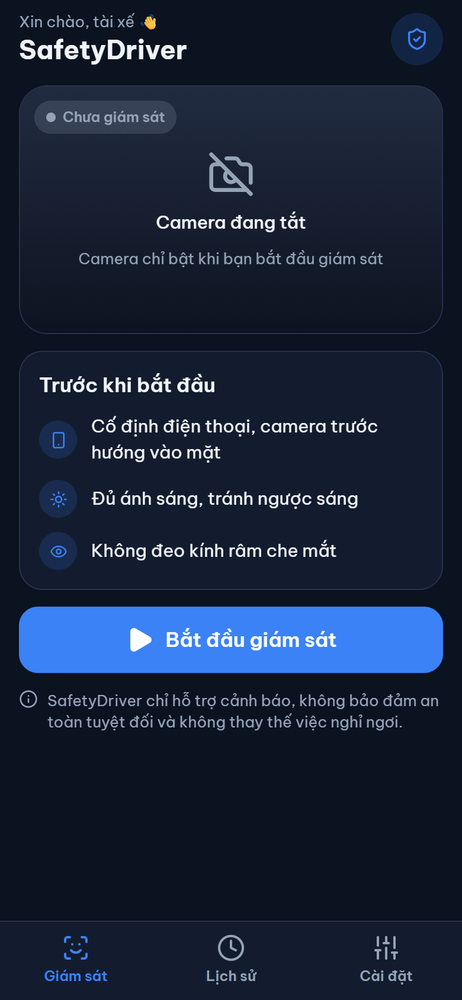
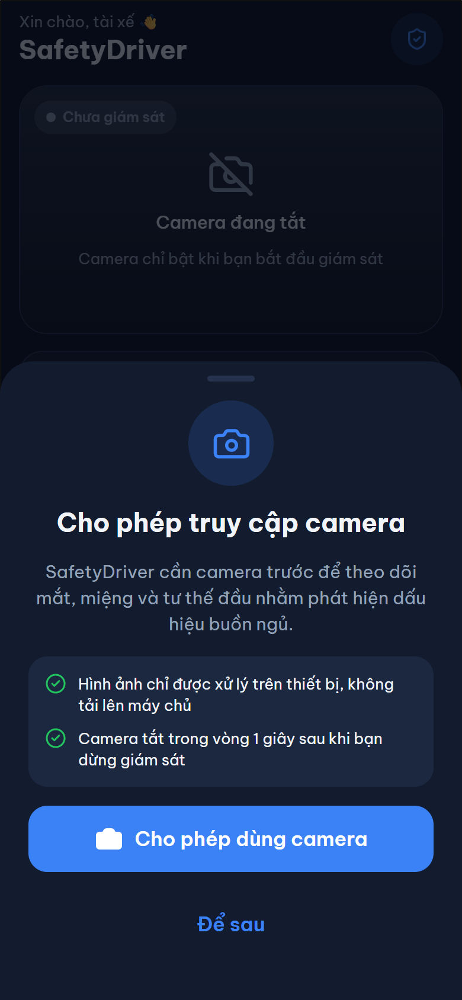
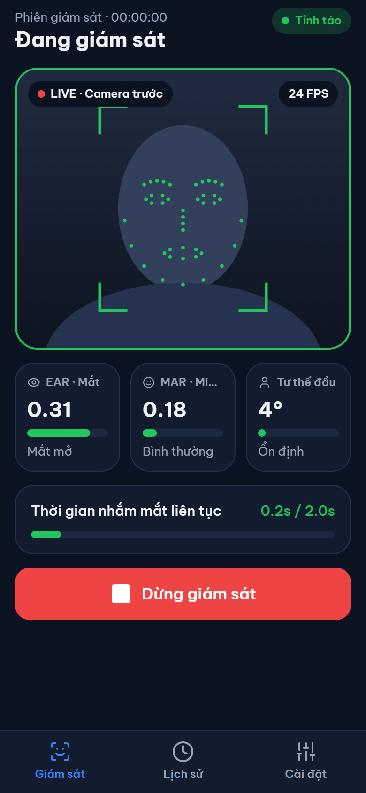
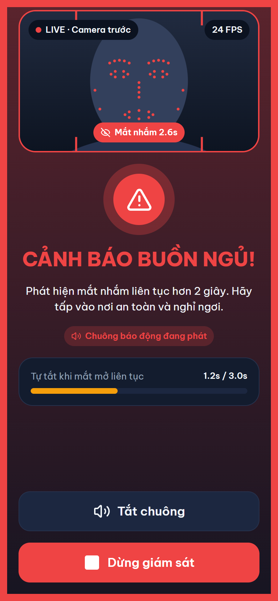
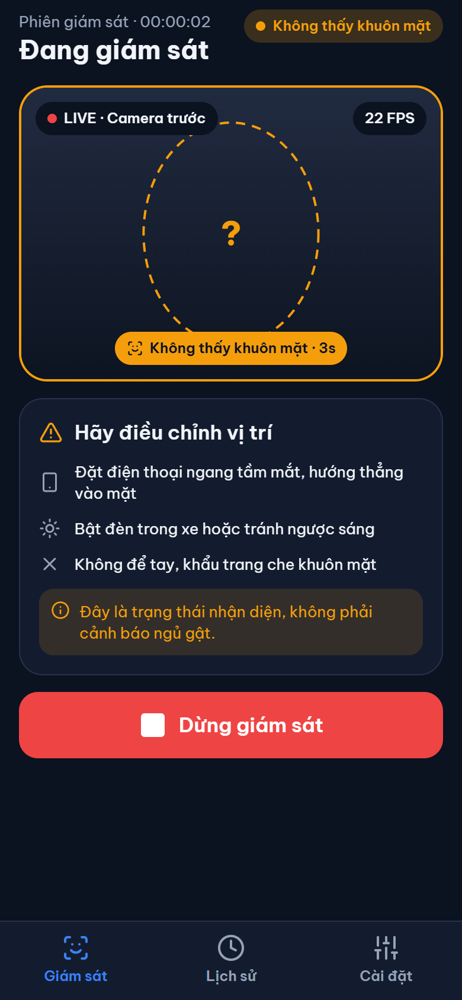
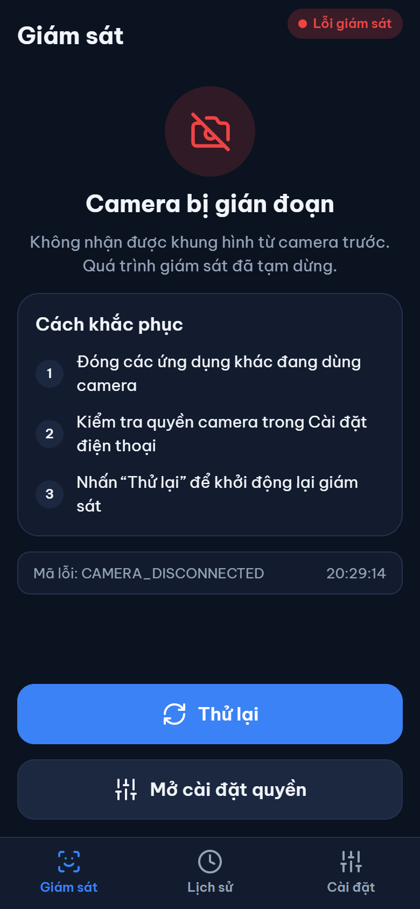
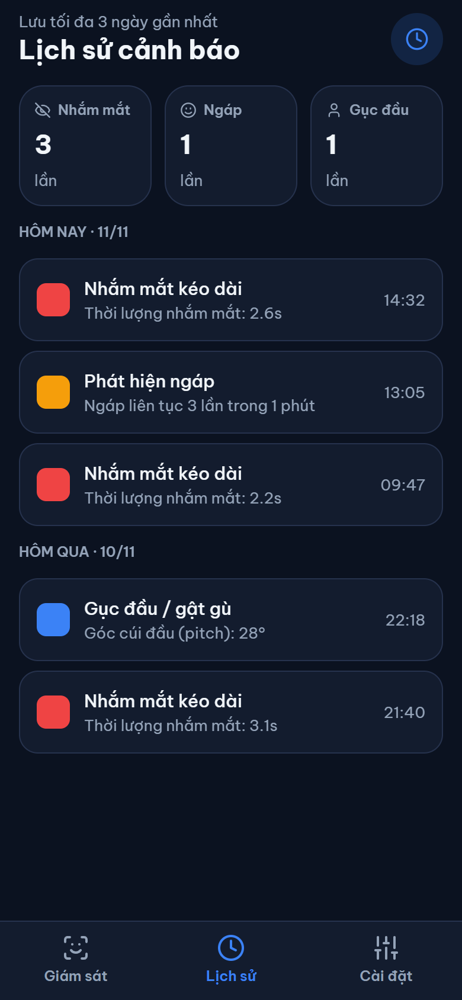
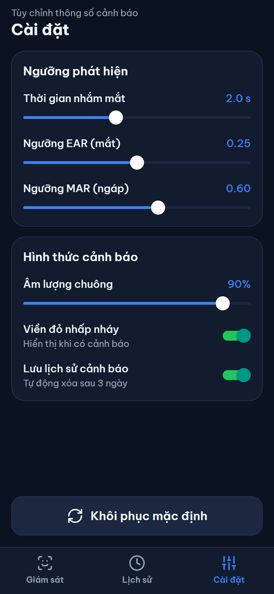

# SafetyDriver Mobile App

This directory is the shared workspace for the mobile application. The planned
stack is **React Native + TypeScript**, with Kotlin/Android native integration
where required. Python is for prototyping and validating computer-vision/ML
algorithms; Python scripts are not assumed to run directly inside React Native.

## Folder structure

- `src/screens/` — app screens and page-level UI
- `src/components/` — reusable UI components
- `src/features/camera/` — camera permission, frame input, camera integration
- `src/features/vision/` — face detection and feature extraction interfaces
- `src/features/drowsiness/` — drowsiness state and decision logic
- `src/features/alerts/` — alert rules and alert presentation
- `src/storage/` — local alert history (currently AsyncStorage, not SQLite)
- `src/types/` — shared TypeScript types and data contracts
- `tests/` — unit and integration tests
- `python-prototype/` — optional Python experiments and evaluation scripts

These are starting folders, not claims that the features have already been
implemented. Add the React Native app scaffold and dependencies when the team
is ready to initialize the mobile project.

## Team workflow

1. Pull the latest `main` before starting work.
2. Create a feature branch for your task; do not commit directly to `main`.
3. Keep changes within the folder/module assigned to you.
4. Run relevant tests and check that the app still builds before opening a PR.
5. Open a Pull Request into `main`; ask another member to review it.
6. Avoid committing API keys, signing keys, private data, raw driver videos,
   or other secrets and sensitive data.

Suggested branch names:
- `feature/ui-home`
- `feature/camera-integration`
- `feature/vision-landmarks`
- `feature/drowsiness-logic`
- `feature/sqlite-history`

Suggested commit messages:
- `feat: add monitoring screen`
- `fix: handle camera permission denial`
- `test: add drowsiness state tests`
- `docs: update mobile setup instructions`

## Before implementing

Agree on the interfaces between camera frames, landmarks, feature values,
drowsiness results, alerts, and database records. Treat missing or invalid
measurements explicitly; do not silently replace them with valid-looking values.

## Running the UI

```
npm ci
npm run web              # browser: live camera preview, no face analysis
npm run android          # debug APK: installs, starts Metro, opens the app
npm run android:release  # release APK: JavaScript is bundled inside, no Metro needed
```

How the UI gets its state from `App.tsx`, and what each state shows, is in
[docs/ui-states.md](docs/ui-states.md).

### "Unable to load script"

The **debug** APK does not contain the app's JavaScript. It downloads it from
Metro on port 8081 every time it opens. The red "Unable to load script" screen
means the app could not reach Metro. It is not a bug in the app code.

It appears when the debug app is opened again after the `npm run android`
terminal was closed, after the computer restarted, or when the APK file was
copied to another phone.

Fix, with the app already installed:

1. Start Metro in `mobile-app` and keep the terminal open: `npm start`
2. Real phone over USB only: `adb reverse tcp:8081 tcp:8081`
   (an emulator reaches the computer by itself)
3. Open the app again, or press `r` in the Metro terminal.

To hand someone an APK that opens without a computer, build
`npm run android:release` and share
`android/app/build/outputs/apk/release/app-release.apk`. It is signed with the
debug key, which is fine for a demo but not for a store release.

The Android development build uses the local `safetydriver-camera` Expo module
(CameraX + MediaPipe Face Landmarker). The first Gradle build downloads the
model and verifies its SHA-256 checksum; an internet connection is required.
Expo Go does not include this local native module. The browser build can show a
live camera preview, but currently does not run face analysis.

On Android, camera frames are analyzed on-device; landmarks, metadata and the
optional face pose matrix are sent to JavaScript, where EAR/MAR/pitch and
continuous measurements drive preliminary alert rules. The native Android module
also produces a repeating alarm tone when the UI enters the alert state. No
additional audio package is required. These rules are not a validated driver-safety
system and must not replace attentive driving or other safety measures. Native
camera and vision support is Android-only; iOS still needs its own native
implementation.

## Screens

Captured from the web build at 390×844 with sample data.

| Home | Camera permission | Monitoring | Drowsiness alert |
| --- | --- | --- | --- |
|  |  |  |  |

| No face detected | Camera error | History | Settings |
| --- | --- | --- | --- |
|  |  |  |  |

## Fix âm thanh cảnh báo và gục đầu

Xem [kiểm thử âm báo và pitch](docs/alert-audio-head-pitch-fix.md). Cần chạy
`npm run check` và rebuild Android native (`npm run android`) trước khi thử
trên điện thoại thật. Mốc pitch và ngưỡng phát hiện gục đầu là thử nghiệm,
chưa được nghiệm thu về độ chính xác hoặc chiều cúi/ngẩng trên máy thật.
