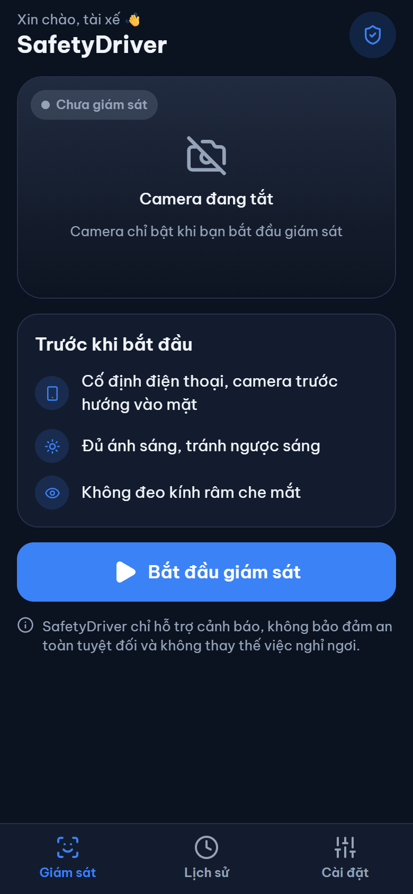
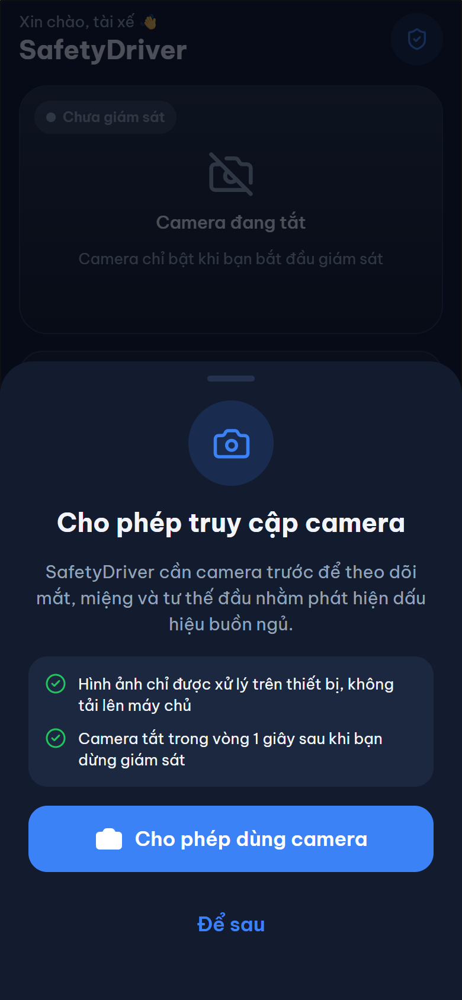
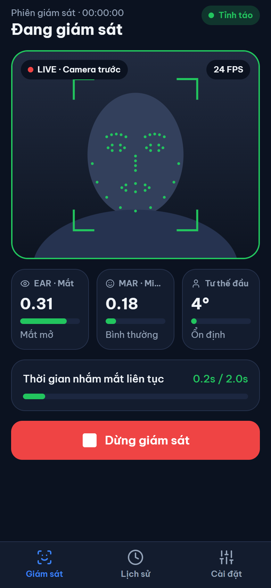
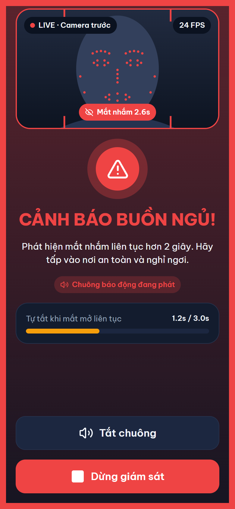
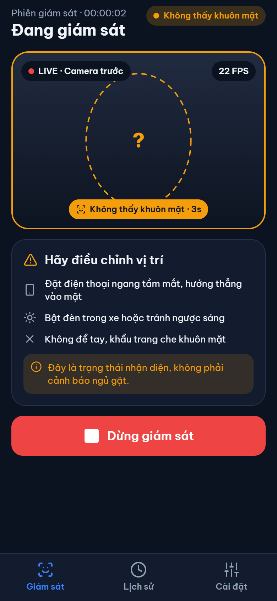
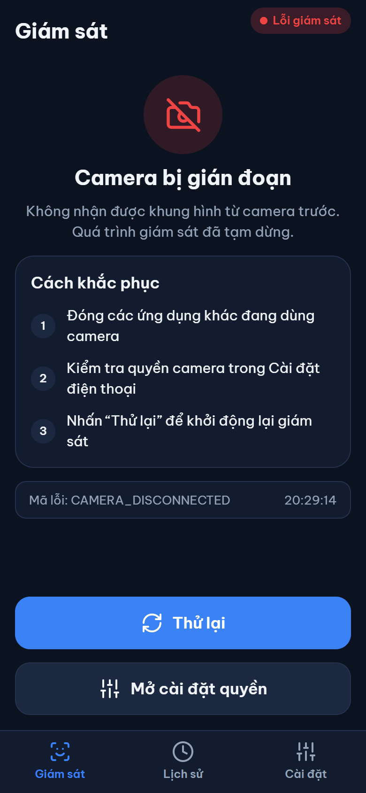
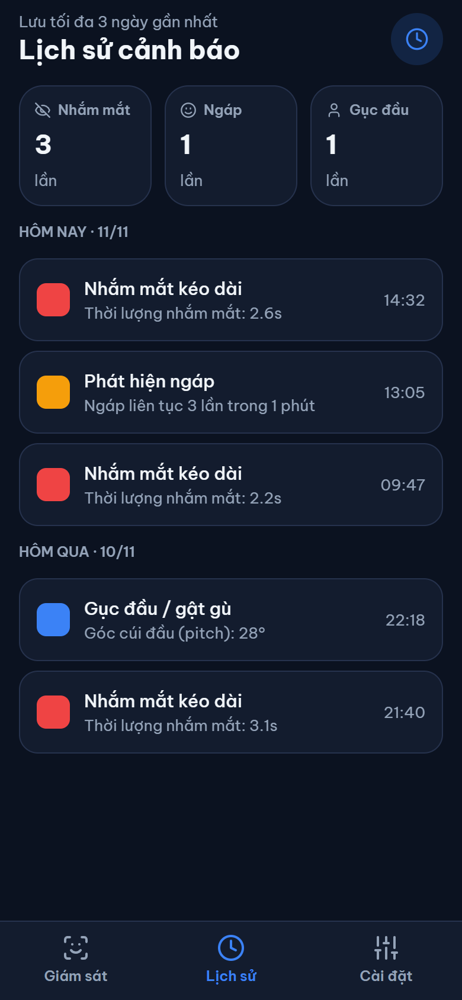
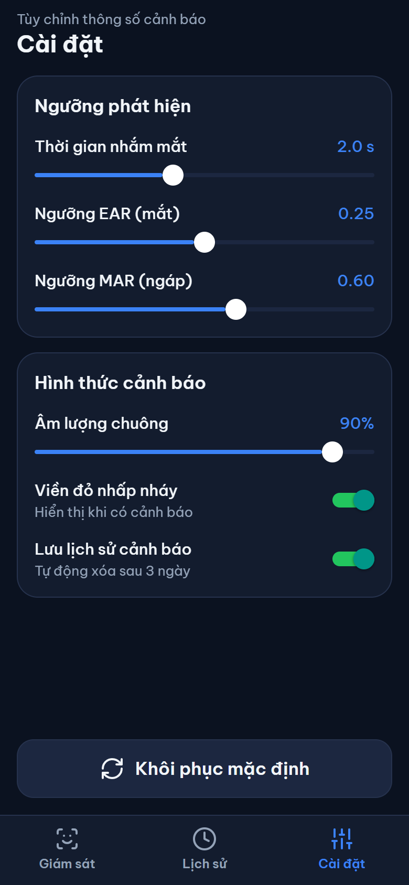

# SafetyDriver Mobile App

This directory is the shared workspace for the mobile application. The planned
stack is **React Native + TypeScript**, with Kotlin/Android native integration
where required. Python is for prototyping and validating computer-vision/ML
algorithms; Python scripts are not assumed to run directly inside React Native.

## Folder structure

- `src/screens/` — app screens and page-level UI
- `src/components/` — reusable UI components
- `src/features/camera/` — camera permission, frame input, camera integration
- `src/features/vision/` — face detection and feature extraction interfaces
- `src/features/drowsiness/` — drowsiness state and decision logic
- `src/features/alerts/` — alert rules and alert presentation
- `src/storage/` — SQLite access and local persistence
- `src/types/` — shared TypeScript types and data contracts
- `tests/` — unit and integration tests
- `python-prototype/` — optional Python experiments and evaluation scripts

These are starting folders, not claims that the features have already been
implemented. Add the React Native app scaffold and dependencies when the team
is ready to initialize the mobile project.

## Team workflow

1. Pull the latest `main` before starting work.
2. Create a feature branch for your task; do not commit directly to `main`.
3. Keep changes within the folder/module assigned to you.
4. Run relevant tests and check that the app still builds before opening a PR.
5. Open a Pull Request into `main`; ask another member to review it.
6. Avoid committing API keys, signing keys, private data, raw driver videos,
   or other secrets and sensitive data.

Suggested branch names:
- `feature/ui-home`
- `feature/camera-integration`
- `feature/vision-landmarks`
- `feature/drowsiness-logic`
- `feature/sqlite-history`

Suggested commit messages:
- `feat: add monitoring screen`
- `fix: handle camera permission denial`
- `test: add drowsiness state tests`
- `docs: update mobile setup instructions`

## Before implementing

Agree on the interfaces between camera frames, landmarks, feature values,
drowsiness results, alerts, and database records. Treat missing or invalid
measurements explicitly; do not silently replace them with valid-looking values.

## Running the UI

```
npm install
npm run web       # live camera preview, without face analysis
npx expo run:android  # native camera and face analysis; needs Android SDK / device
```

The Android development build uses the local `safetydriver-camera` Expo module
(CameraX + MediaPipe Face Landmarker). The first Gradle build downloads the
model and verifies its SHA-256 checksum; an internet connection is required.
Expo Go does not include this local native module. The browser build can show a
live camera preview, but currently does not run face analysis.

On Android, camera frames are analyzed on-device; only landmarks and frame
metadata are sent to JavaScript, where EAR/MAR and continuous eye-closure timing
drive preliminary alert rules. These rules are not a validated driver-safety
system and must not replace attentive driving or other safety measures. Native
camera and vision support is Android-only; iOS still needs its own native
implementation.

## Screens

Captured from the web build at 390×844 with sample data.

| Home | Camera permission | Monitoring | Drowsiness alert |
| --- | --- | --- | --- |
|  |  |  |  |

| No face detected | Camera error | History | Settings |
| --- | --- | --- | --- |
|  |  |  |  |
